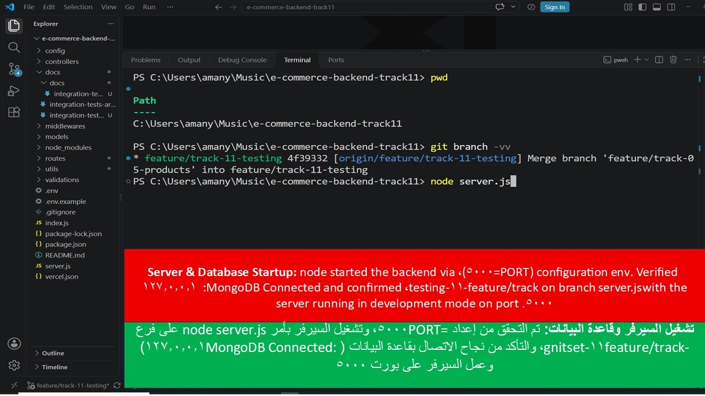
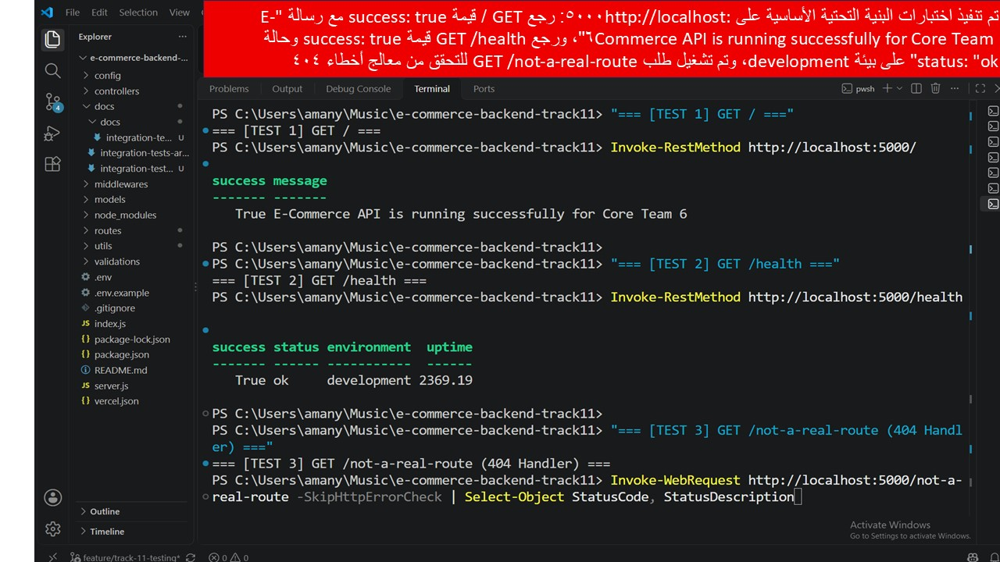
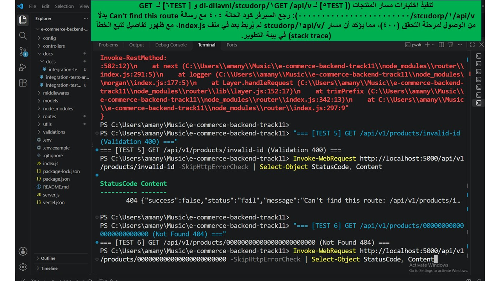

# Integration Tests Report — E-Commerce Backend (Track 11)

## 1. Environment & Repository Verification
- **Local Workspace:** `C:\Users\amany\Music\e-commerce-backend-track11`
- **Active Branch:** `feature/track-11-testing` (HEAD: `4f393326a03c2e09e809b52858ad478ff6224bc7`)
- **Base URL:** `http://localhost:5000`
- **Database:** MongoDB Local (`127.0.0.1`) — Connected
- **Branch Sync Status:** Up to date with `origin/develop` (`0` commits behind; `+13` commits ahead from merged `feature/track-05-products`)
- **Audit Date:** 2026-11-27

## 2. Executed Tests Summary

### A. Core & Infrastructure Checks
| Endpoint | Method | Expected | Actual | Status | Notes |
| :--- | :--- | :--- | :--- | :--- | :--- |
| `/` | `GET` | `200 OK` | `200 OK` (`success: true`) | `PASS` | Returned `"E-Commerce API is running successfully for Core Team 6"` |
| `/health` | `GET` | `200 OK` | `200 OK` (`status: "ok"`) | `PASS` | Confirmed `environment: "development"` and active uptime |
| `/not-a-real-route` | `GET` | `404 Not Found` | `404 Not Found` | `PASS` | Global 404 error handler works properly |

### B. Track 05 — Products Module (`/api/v1/products`)
| Endpoint | Method | Access | Expected | Actual | Status | Notes |
| :--- | :--- | :--- | :--- | :--- | :--- | :--- |
| `/api/v1/products` | `GET` | Public | `200 OK` + products list | `404 Not Found` | `FAIL` | Route not mounted in `index.js` yet (`Can't find this route`) |
| `/api/v1/products/invalid-id` | `GET` | Public | `400 Bad Request` (Validation) | `404 Not Found` | `FAIL` | Blocked by unmounted router before reaching `getProductValidator` |
| `/api/v1/products/:id` | `GET` | Public | `200 OK` / `404` | `Pending` | `BLOCKED` | Waiting for `/api/v1/products` mount in `index.js` |
| `/api/v1/products` | `POST` | Admin | `201 Created` | `Pending` | `BLOCKED` | Waiting for `/api/v1/products` mount in `index.js` |
| `/api/v1/products/:id` | `PUT` | Admin | `200 OK` | `Pending` | `BLOCKED` | Waiting for `/api/v1/products` mount in `index.js` |
| `/api/v1/products/:id` | `DELETE` | Admin | `200 OK` / `204` | `Pending` | `BLOCKED` | Waiting for `/api/v1/products` mount in `index.js` |

## 3. Audit Findings & Action Items
1. **Unmounted Product Router (High Priority):** Although `feature/track-05-products` was merged into `feature/track-11-testing` (`models/Product.model.js`, `controllers/product.controller.js`, `routes/product.routes.js`, `validations/product.validation.js`, `utils/apiFeatures.js`), requesting `/api/v1/products` returns `404 Not Found` because the route is not yet mounted in `index.js`.
2. **Missing Reviews Route Dependency:** `routes/product.routes.js` imports `./review.routes.js`, which is not yet merged into `develop` or `feature/track-11-testing`. A local temporary stub is currently used for server startup.

## 4. Remaining Modules (Pending Merge)
- [ ] Auth (`/api/v1/auth`)
- [ ] Users (`/api/v1/users`)
- [ ] Categories (`/api/v1/categories`)
- [ ] Brands (`/api/v1/brands`)
- [ ] Reviews (`/api/v1/products/:productId/reviews`)
- [ ] Carts (`/api/v1/carts`)
- [ ] Wishlists (`/api/v1/wishlists`)
- [ ] Orders (`/api/v1/orders`)
- [ ] Payment (`/api/v1/payment` & webhook)@'
## 5. Test Evidence Screenshots | لقطات الأدلة والاختبارات

### Slide 3 — Environment & Server Setup | تهيئة البيئة وتشغيل السيرفر

> **EN:** Verified local workspace path (-commerce-backend-track11), active branch eature/track-11-testing (4f39332) after merging eature/track-05-products, and initiated server startup via 
ode server.js.
>
> **AR:** تم التحقق من مسار المشروع والعمل على فرع eature/track-11-testing بعد دمج فرع المنتجات (eature/track-05-products)، وبدء تشغيل السيرفر بأمر 
ode server.js.

### Slide 4 — Core Infrastructure & Health Checks | فحص البنية التحتية وحالة السيرفر

> **:** Executed core infrastructure checks on http://localhost:5000: GET / returned success: true with "E-Commerce API is running successfully for Core Team 6", GET /health returned success: true, status: "ok", and nvironment: "development", and GET /not-a-real-route was triggered to verify the 404 error handler.
>
> **:** تم تنفيذ اختبارات البنية التحتية الأساسية على http://localhost:5000: رجع GET / قيمة success: true مع رسالة "E-Commerce API is running successfully for Core Team 6"، ورجع GET /health قيمة success: true وحالة status: "ok" على بيئة development، وتم تشغيل طلب GET /not-a-real-route للتحقق من معالج أخطاء 404.

### Slide 5 — Products Route 404 Finding | نتيجة اختبار مسار المنتجات (404)

> **:** Executed Product endpoint tests for invalid and non-existent IDs (GET /api/v1/products/invalid-id and GET /api/v1/products/000000000000000000000000): both returned HTTP 404 (Can't find this route) instead of reaching validation (400), confirming that /api/v1/products is not yet mounted in index.js.
>
> **:** تم تنفيذ اختبارات مسار المنتجات لمعرّفات غير صالحة أو غير موجودة (GET /api/v1/products/invalid-id و GET /api/v1/products/000000000000000000000000): رجع السيرفر كود الحالة 404 (Can't find this route) بدلًا من الوصول لمرحلة التحقق (400)، مما يؤكد أن مسار /api/v1/products لم يُربط بعد في index.js.
